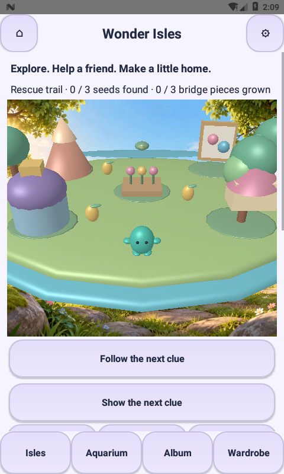
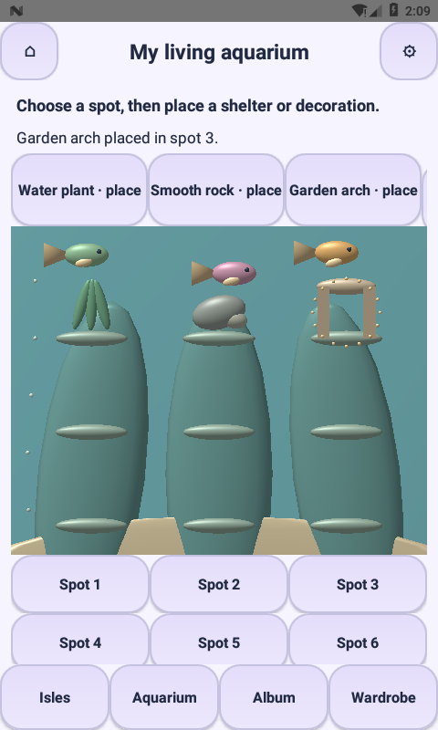
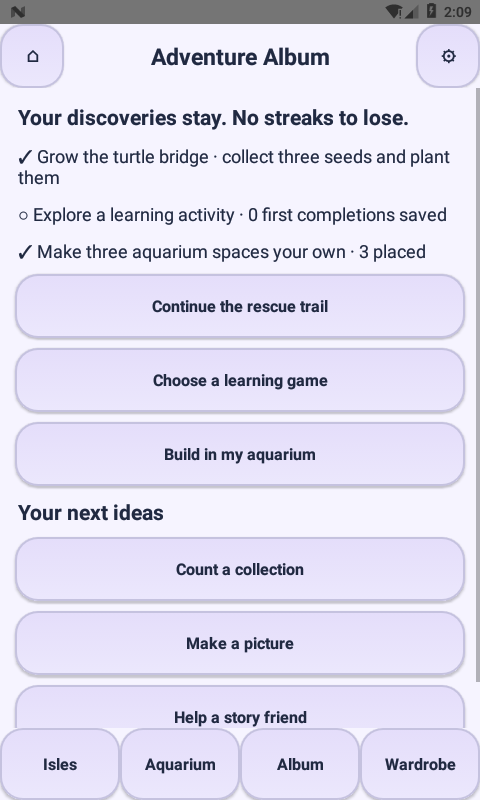

# Little Makers 2.8.0 — Wonder Isles adventure integration

## Implemented in the existing native app

The opening Play button now enters a native adventure lobby. It keeps the existing 1,200 learning levels, 210 story scripts, clay, coloring, texture reveal, shapes, fish activity, drawing books, saved creations, wallet and parent controls. Direct entry buttons remain available; the previous village map is still reachable.

### Explore → help → build → return to learning

- Guided third-person movement on an original mesh island. Tap ground to walk; horizontal drags turn the camera. Optional lower-left joystick, a map/follow toggle and recenter control support different motor abilities.
- A bounded grid route planner walks around landmark collision volumes instead of stopping at them. Ground picking uses the inverse camera projection, with island bounds and an unfinished-stream barrier.
- One complete introductory rescue: find three distinct seed pods, explicitly collect each, then plant three individually counted bridge sections and watch a turtle cross to the near bank. No combat, lives, countdown, failure screen or random reward.
- Activity portals and direct buttons connect to Clay Mountain, Color Meadow, Shape Space, Story Tree, Texture Garden and the existing game library. Returning from a destination restores the adventure screen.
- Your equipped skin and accessory appear on the island companion. The existing coin-funded wardrobe remains connected.

### Build a living aquarium

- Nine selectable build spots, also available through large labeled native buttons.
- Three free starter decorations: water plant, smooth rock and garden arch. Shell shelter, soft coral and treasure nook unlock at visible totals of 2, 4 and 6 stars. There is no random loot or paid material gate.
- Place, replace or clear a decoration. Layouts survive Activity recreation and app restart. Terraced reef supports, plants, bubbles and moving mesh fish make the collection visible.
- Decoration unlocks read the existing central wallet. The first bridge completion uses the same SQLite completion/ledger transaction as the creative activities: five coins and one star, once only. A recovered completed mission reconciles an interrupted reward idempotently.

### Adventure Album

Persistent goals cover the turtle rescue, a learning activity and three aquarium decorations. Learning completion excludes the rescue reward itself, so one objective does not silently satisfy the other. Suggested activities link into the current content. Progress does not expire; no streak loss, public leaderboard or timed battle pass is introduced.

## Engineering and preservation

- Framework Java, custom Views and GLES2; no runtime engine, WebView, Internet permission, third-party games, advertising or tracking SDK.
- Renderer callbacks return to the UI thread; movement/world state and build layouts have explicit synchronization. Backgrounding pauses rendering and saves state.
- Reduced motion freezes decorative movement while preserving player-directed travel. Sound and haptics use the current settings and audio engine.
- The existing parent-gated reset now also clears adventure and habitat preferences. Returning from reset reloads empty state instead of writing old in-memory progress back.
- New Activity is internal/unexported. The Android launcher, parent PIN gate, release signing and publisher-policy checks remain in place.

## Scope

This is an integrated adventure lobby and one complete rescue expedition around the existing educational activities. It does **not** turn every existing lesson into a separate third-person mission, reproduce Free Fire graphics, add combat/PvP, or produce photorealistic assets. The aquarium is a nine-slot builder, not a full Fishdom simulation. “4D” describes responsive 3D plus motion, sound and haptics; it is not a fourth spatial dimension.

## Verification

`AdventureStateTest` checks guided paths, collisions, bounds, unique seed counts, bridge traversal, safe input/save restoration, decoration gates and reset. Existing rule/save/content tests remain required. `AdventureCheck`, in the separate instrumentation APK, walks the real renderer-driven route and checks UI collection/building, central wallet idempotency, aquarium placement and Activity recreation. Actual results and emulator screenshots are recorded in `verification/ADVENTURE-2.8.0.json` after the run.

Physical-device frame rate, broad GPU/Android coverage, complete accessibility acceptance and Play production release checks remain separate.

## Actual device results

Nine API 24 emulator checks passed, including real guided walking, seed collection, bridge building, central-wallet idempotency, decoration placement, Activity recreation, linked art/game navigation and dark/reduced-motion UI. This does not certify physical-device 60fps or full all-level playthroughs.

