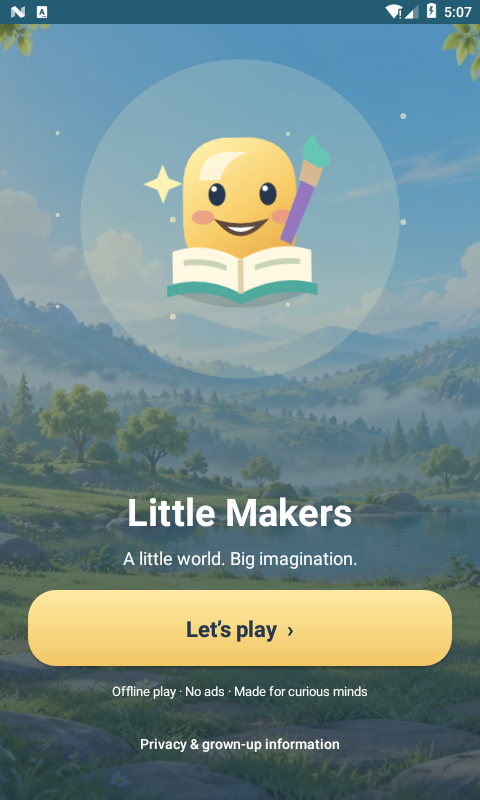
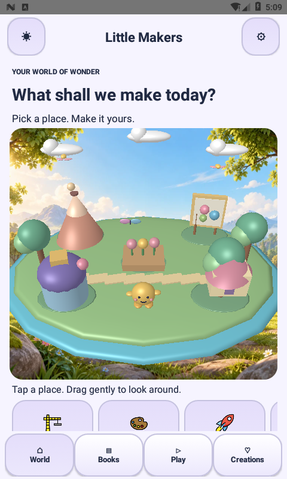

# Little Makers 2.5.0 — opening, logo and environment

## Implemented
- New original golden reading-and-painting mascot. Native vector foreground, teal/navy background, API 26 adaptive icons, round icon and API 33 monochrome layer. The 512px Play listing icon and editable SVG are exported from the same vector geometry.
- OpeningActivity is now the actual launcher. LaunchTheme provides a native icon startup window on API 24–30 and Android 12+ splash attributes on API 31+. Version-gated platform exit animation does not introduce a fixed loading delay.
- Interactive welcome scene: illustrated forest, gently floating mascot and motes, readable title, large immediately available Play button and internal privacy access. Landscape uses a side panel; scrollable text accommodates constrained height. Reduced-motion and system animation settings stop decorative movement.
- Original forest/pond landscape behind the actual 3D village, not a replacement for its meshes. GPU texture upload respects texture-size limits; center-cover cropping preserves aspect ratio and bounds. The backdrop has subtle camera-relative parallax and a darker treatment in dark mode.
- Animated birds and butterfly, moving clouds/canopies, brighter material highlights and the existing expressive companion. Navigation, 1,053 pictures, 210 scripts, 1,200 levels and local wallet remain intact.

## Scope and verification
“4D” is interpreted as immersive 3D plus motion, sound and haptics; this is not a fourth spatial dimension. The textured environment is 2D illustrated artwork behind real 3D geometry. Story and drawing screens remain primarily 2D. No stereoscopic/AR features, network permission, advertising or runtime game-engine dependency were added.

Build/signature checks, previous game/save/audio/navigation/content checks, native icon/theme checks, and 100 viewport/pan crop cases pass. See verification/BRANDING-2.5.0.json for actual emulator observations. API 31+/33 resource variants are compiled but need modern-device visual acceptance; physical-device performance and full accessibility remain pending. The direct SDK build does not certify Android Studio dependency resolution in every environment.

## Asset provenance
The mascot, native icon paths and welcome motion are original code-authored assets. The environmental illustration was generated with the built-in image-generation tool on 24 October 2026; see art-source/forest-background-prompt.txt for the complete production prompt. It was encoded to WebP for offline delivery (no content compositing or retouching). Existing OpenMoji and Kenney notices remain unchanged. Re-export the logo using tools/export-brand.py (cairosvg is a development-only dependency).

## Files
- app/src/main/res/drawable/brand_mascot.xml — editable native logo
- app/src/main/res/mipmap-anydpi* — legacy/adaptive/round/themed icons
- art-source/logo-2.5.0.svg — editable brand master
- release/media/play-icon-512.png — listing icon
- app/src/main/assets/webart/forest_backdrop.webp — original new environmental background
- OpeningActivity.java / ForestBackdrop.java — welcome scene and village background

Use main and preserve your existing signing key to retain local progress during upgrades. Release identity/privacy URL/signing guards remain in effect; this is not a Play approval guarantee.

## Actual emulator opening screen

