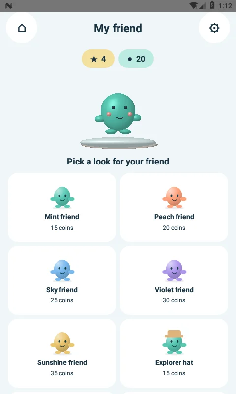
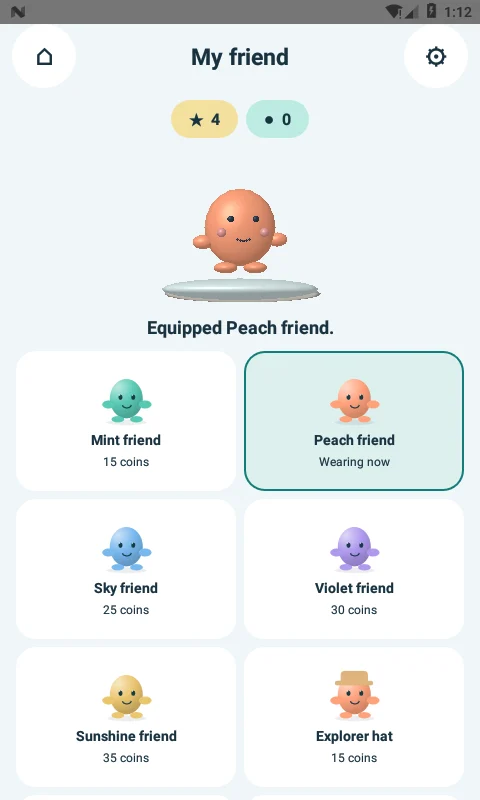
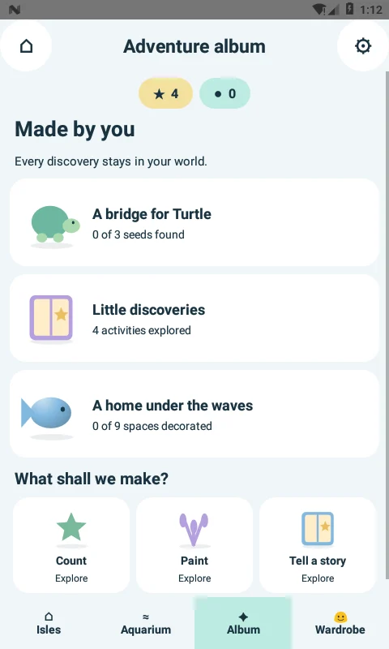
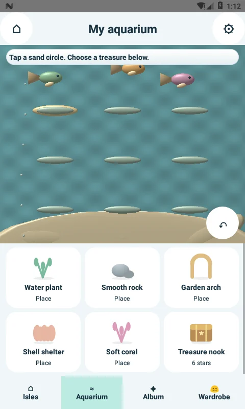
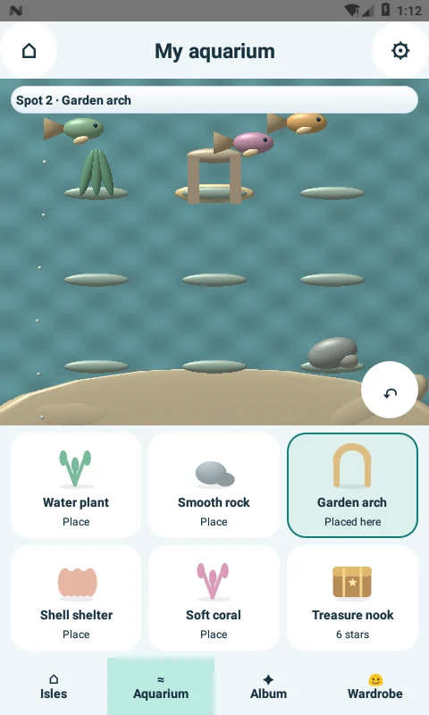
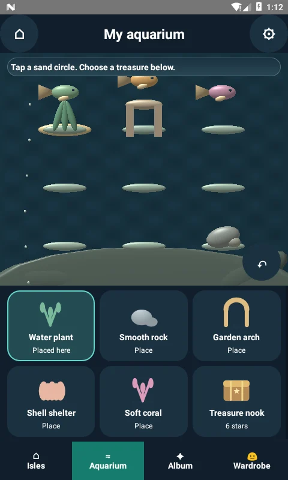

# Little Makers 3.4.0-native (31)

The wardrobe, adventure album and aquarium are redesigned around the game artwork. Shared controls across the native activities use a quieter ocean palette, smaller corner radii, bold labels and no stock raised-button shadow.

| Screen | Previous layout | This release |
| --- | --- | --- |
| Wardrobe | Coin-policy paragraph and eight full-width price buttons | Compact balance chips, live 3D avatar on a display plinth, two-column illustrated looks, explicit price/owned/wearing states |
| Adventure album | Text checklist and repeated large action buttons | Illustrated milestone cards with saved counts and a compact creative activity shelf |
| Aquarium | Oversized decoration buttons, tall background pillars, nine extra spot buttons | One prominent live viewport, low sand banks, direct sand-circle selection, six illustrated decoration cards and a small clear control |

## Shared design

* Light: background `#F0F6F8`, text `#193240`, white cards, mint tonal controls `#DCF0ED`.
* Dark: background `#101F2C`, white text, cards `#1B3140`, tonal controls `#244B53`.
* Primary scene action: teal gradient `#167B80` to `#086168`, white text.
* Native bold sans-serif; 23sp screen titles, 18sp milestone titles, 14sp item titles, 12–14sp secondary copy. TextViews participate in system font scaling.
* 64dp minimum shared controls. Illustrated cards are native, focusable targets with explicit spoken labels. Aquarium spots expose nine virtual accessibility nodes with click, focus and hover support.
* Press transforms respect reduced motion. Illustration paths and gradients are cached and do not run idle animation loops. Motion is concentrated in the live game scene.

## GPU and response work

The aquarium keeps one GLES renderer. Wardrobe cards add no GL surfaces, and buying/equipping updates the existing avatar renderer instead of destroying and rebuilding it. The album needs no GL surface.

Aquarium meshes now upload to persistent vertex buffers once per context. Consecutive uses of the same mesh reuse buffer and attribute setup. The water time uniform updates once per frame. A two-draw selected halo replaces sixteen small sphere draws; fish colors are cached. State is copied into a reusable nine-slot snapshot under a short lock, then drawing happens outside that lock. Reduced-motion aquarium rendering remains on demand.

These are implementation improvements, not a measured 60fps guarantee. The visuals remain stylized original 3D scenes with Canvas-drawn UI illustrations. This is a local native game, not a cloud game-streaming service.

## Validation and compatibility

See `verification/GAME-HUD-3.4.0-rules.txt`, `verification/GAME-HUD-3.4.0-device.txt` and `verification/GAME-HUD-3.4.0.json` for actual results. Device checks cover wallet purchase and repeat equip, renderer identity, single-viewport structure, native accessible placement, vertex-buffer upload, GL error state, saved decoration restore and dark/reduced-motion presentation.

`Hud34Check` is for an **isolated disposable emulator only**: it resets the test wallet and seeds known first-completion rewards. It is compiled into the separate render-check APK, not the production app.

Existing wallet/progress keys, content, parent PIN, private creations, offline behavior and signing identity remain compatible. Minimum Android API24, target API36. This is a development-signed build. Real-device GPU profiling, sustained frame pacing, thermal behavior and the wider Android/GPU matrix remain unverified.

## Actual emulator captures

