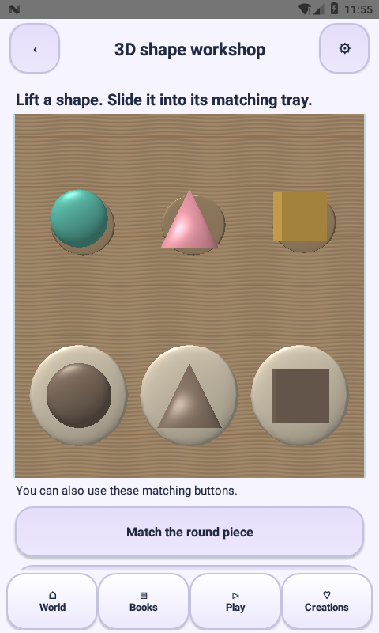
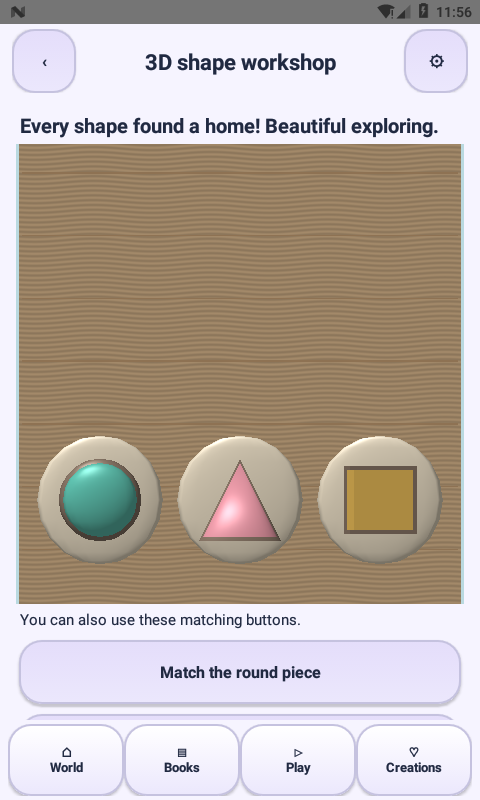
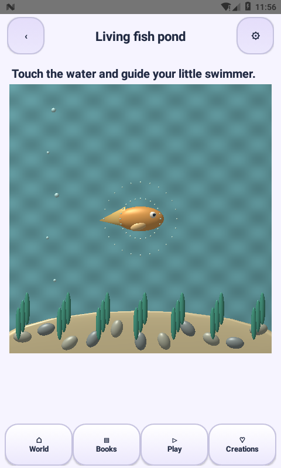

# Native 3D gameplay — 2.6.0

The earlier release upgraded the village and opening, while Shape Space and Fish Pond were still flat Canvas screens. This update replaces those two activity views with real OpenGL ES 2 mesh scenes, reached through the existing village/playroom routes.

## Shape workshop

Solid round, pointed and square pieces have directional lighting, specular highlights, depth, raised matching trays and contact-shadow geometry on a wooden workbench. Pieces lift during drag, settle into the matching tray and ease home after a mismatch. Completion triggers the existing distinct win sound and local first-completion reward (`shape-0`); resetting does not farm coins. Three labeled native matching buttons provide an alternative to dragging.

## Living fish pond

An original mesh fish follows touch position with time-based easing. Body, eye, tail and fin are independent geometry. Moving ripples, rising bubbles, swaying plants, stones and subtle animated water shading create an interactive pond. This is open-ended cause-and-effect play, with no timer or reward pressure.

## Implementation

`PlaySceneSurface` owns its GL resources and rendering thread. UI input is queued onto that thread; callbacks are posted back to the Activity. `ShapePlayState` is independent of Android and tested for matching, incorrect drops, reset, clamped motion and duplicate-match protection. Activity lifecycle pauses rendering, reduced-motion mode removes ambient movement and immediately settles input changes, and system animation settings are respected. Unsupported graphics initialization retains the existing Canvas fallback. Graphics use original procedural meshes/shaders; no runtime engine library, external app, Internet permission or new third-party artwork is introduced.

This is polished stylized 3D, not photorealistic rendering. Stories, drawing books and the twenty legacy game mechanics still use their existing 2D renderers. This update does not convert all 1,200 levels into distinct 3D games. Physical-device frame rate, wider GPU coverage and complete accessibility acceptance remain to be measured.

## Verification

SDK 36 Java/resources/DEX compile and APK signature verification pass. The complete existing rule/content/navigation suite and new shape-state tests pass. Device observations are recorded in `verification/GAMEPLAY-2.6.0.json` after the emulator run.

## Actual device captures

