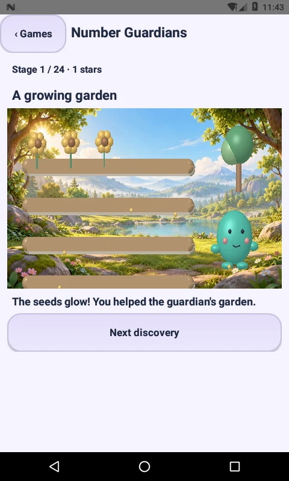
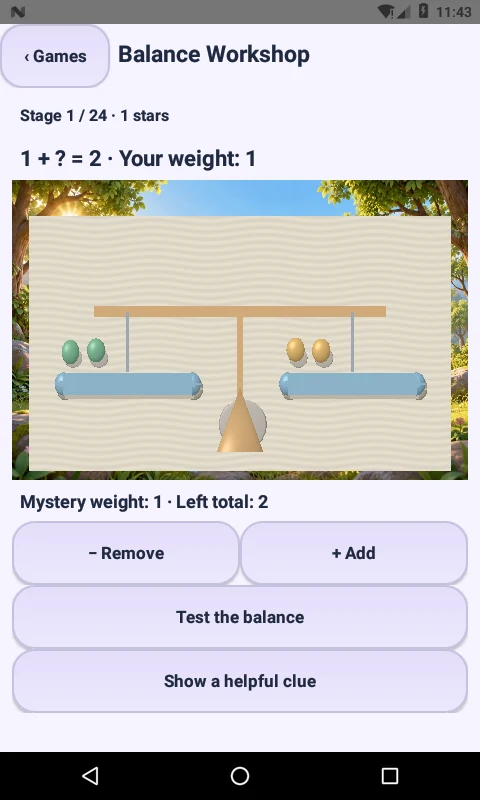
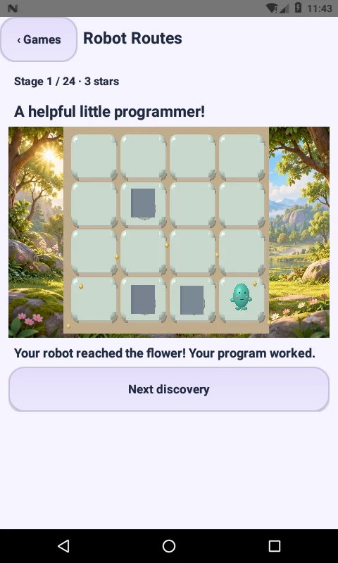
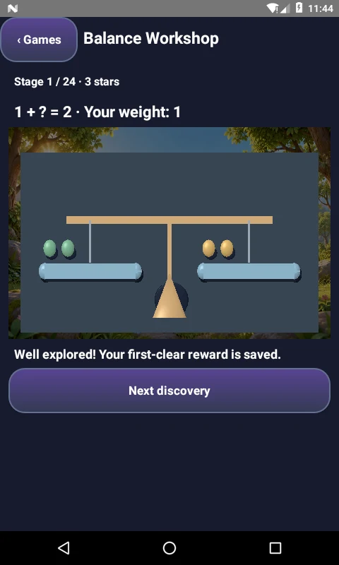

# Little Makers 2.9.0 — Original learning quests

Three new offline native games are reachable from **Wonder Isles → New · Number Guardians, Balance & Robot Routes** and **Little Playroom → Learning quests**. Opening Play still enters Wonder Isles. Existing activities and saved data remain available.

## What is playable

- **Number Guardians:** 24 stages, three local difficulty bands (counting, addition, mixed addition/subtraction). Two consecutive correct answers move up a band; two incorrect attempts move down. Wrong answers offer a counting clue without removing progress. Solve a question to bloom the guardian's garden. Difficulty adapts locally; it is not a calibrated student assessment.
- **Balance Workshop:** 24 stages. Add/remove mystery weights, compare the visibly tilting pans, then test equality. The same relationship is shown in numbers and 3D counters. Children can experiment without a loss screen.
- **Robot Routes:** 24 obstacle layouts on a 4×4 board. Compose up to 32 forward/left/right commands, undo or clear them, then execute the sequence. The robot moves between cells with eased motion; a blocked step stops safely for editing. Every layout has a reachable flower and an optional safe-route clue.

This is **three game mechanics with 72 stages**, not 72 distinct games or the complete catalog of reference products. These are original Little Makers experiences. No third-party characters, lessons, app links or runtime engines were embedded.

## Integration

`LearningQuest.java` contains Android-independent bounded rules. `QuestActivity.java` provides theme-aware native buttons and labels, accessible program controls, optional offline English system speech, GL lifecycle handling and a shared `NativeStageSurface` 3D scene. If an offline English voice is absent, the written question remains available; the app does not request voice downloads. Graphics are stylized procedural meshes, not photorealistic environments.

Each new stage's first clear goes through the existing transactional `PlayerWallet.creativeCompletion`: **5 coins and 1 star**, with a stable mode/stage key in the same completion table and ledger. Reopening/replaying that stage does not award again. Existing wallet totals, wardrobe and aquarium unlocks therefore work without schema changes.

Stage number, math band/streak, balance weights, command program and completion state persist locally. Activity recreation restores the selected game. Interrupted robot execution stops; the saved program can be rerun from the start. Parent Reset clears the new preferences and uses a generation marker so an older Activity cannot revive a reset session. No additional Android permissions or runtime dependencies were added.

## Validation

- SDK 36 Java/resource/DEX build and APK signature checks.
- Existing regression suite, including 1,200 legacy levels and save compatibility.
- **1,839 new rule assertions** covering all 72 stages across all math bands, unique correct choices, adaptation, balance solutions, robot route solvability, movement boundaries, command limits and repeated-win guards.
- Source guards for launcher access, internal activity, shared rewards, lifecycle, parent reset and offline speech.

**Eight API 24 software-GLES emulator checks passed** for actual controls, meshes, adaptive questions, balance, robot collision/undo/run, three wallet awards, reward idempotency, Activity recreation and dark/reduced-motion visuals. Results: `verification/LEARNING-QUESTS-2.9.0-device.txt`. AndroidRuntime showed no errors in this flow. Physical-device GPU/performance coverage and Play release acceptance are separate checks; this is a debug APK.

## Actual emulator captures

