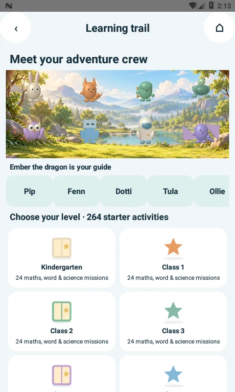
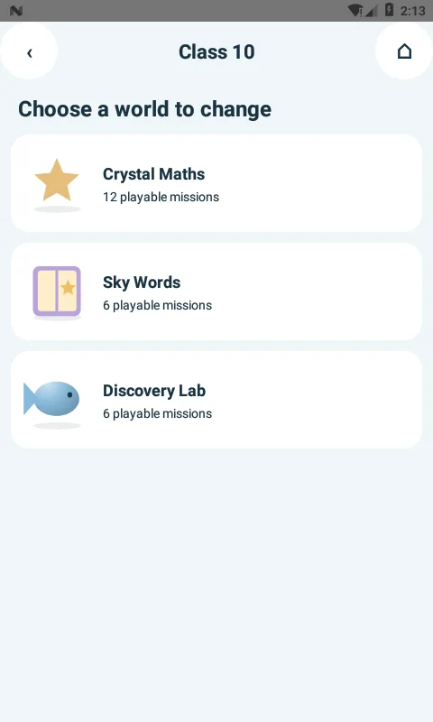
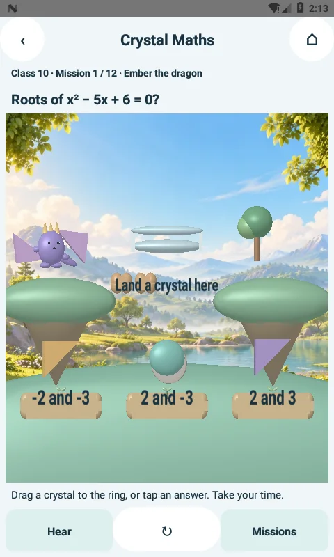
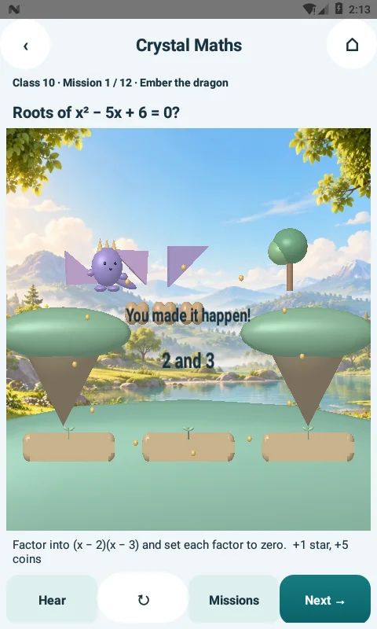
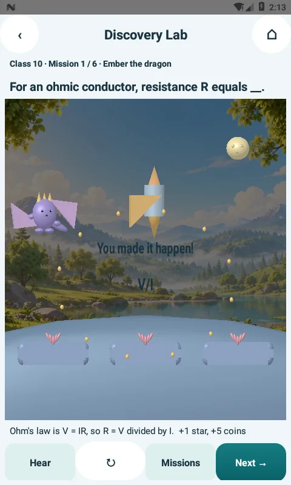
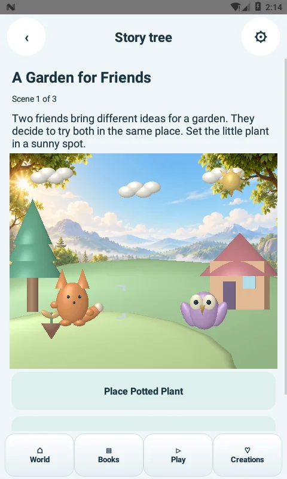
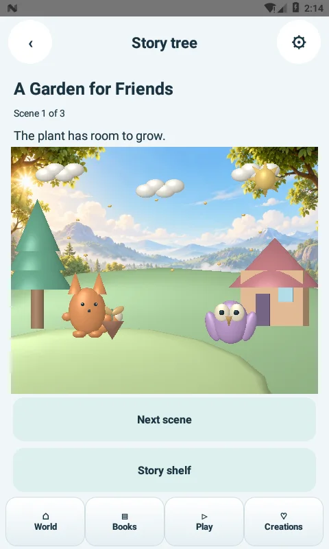
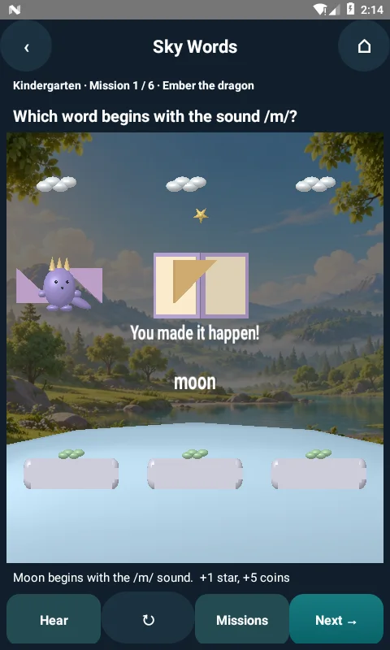
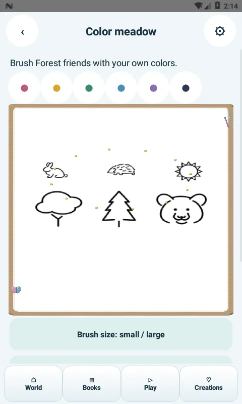

# Little Makers 3.5.0-native (32)

## What is new and where to find it

**Isles → Learn K–10**, **Album → Learning trail**, or the prominent **Learning trail** card on Play, the puzzle shelf and the creative-adventure picker.

The album's second milestone now opens the actual Learning Trail, not the island/home route. Story Back returns to the story shelf. Learning Back follows mission → mission list → subject → level; the explicit Home/close control exits to the calling activity.

### 264 original starter activities

| Level bands | Maths per band | English per band | Science per band | Total |
| --- | --- | --- | --- | --- |
| Kindergarten + Classes 1–10 (11 bands) | 12 | 6 | 6 | 264 |

132 maths activities cover counting, number operations, shape sides, place value, fractions, decimals, area, volume, ratio, percentages, equations, factorisation, coordinates, probability, trigonometry and quadratic roots. There are 66 English activities progressing from sounds and letters to grammar, imagery and argument, and 66 science activities progressing from senses/plants/materials to cells, energy, circuits, lenses and inheritance.

This is a general starter collection. It is not a complete or school-board-certified K–10 syllabus. The 264 entries use three shared play mechanics/worlds; they are not 264 separate game engines. All levels are available without purchases or daily locks.

### Three reactive 3D play worlds

* **Crystal Maths:** drag the correct answer crystal to the landing ring; bridge sections appear and the guide travels across it.
* **Sky Words:** answer with word crystals; the book unfolds and a star rises between its pages.
* **Discovery Lab:** answer with concept crystals; the rocket lifts away from its launch pad.

Tap and virtual accessibility-node alternatives support children who cannot drag reliably. Incorrect attempts offer a teaching explanation and allow another try. Hear uses an installed offline system voice when available. Each activity has one fixed first-clear reward of 1 star and 5 coins. Replays are available and cannot farm coins. The existing SQLite completion ledger is the source of truth; parent reset clears school rewards with other progress and clears the local companion preference.

### Eight original companions and more responsive stories

Pip (rabbit), Fenn (fox), Dotti (dinosaur), Tula (turtle), Ollie (owl), Bolt (robot), Nova (explorer) and Ember (dragon) have different native 3D silhouettes and poses. All are freely selectable as a guide by tapping their 3D figure or using the labelled selection controls.

The existing 210 scripted story episodes now choose deterministic companion pairs from this cast for land scenes. Successful placements trigger travel/hopping and a brief particle reaction. Ocean stories retain their aquatic scene actors. Existing scripts, three-step structure, choices and saved story IDs are preserved; this release does not add prerecorded cinematic videos. Compatibility fallbacks remain available on devices that cannot initialize GLES.

## Rendering and input

The new activity keeps one live GLES viewport. Mission progression and replay reuse its renderer. Native answer hit regions match the visual scene; coordinates are copied from touch events before asynchronous animation. Outcome progress is committed before the transport animation, and reward replay is idempotent.

The shared renderer compensates model Y scale for viewport aspect so character/prop proportions remain natural while input centres retain their normalized positions. The shared mesh renderer now uploads reusable GPU vertex buffers, caches consecutive mesh bindings and restores the main shader after drawing art textures. Story UI display lists update during gestures and the short object-placement transition, instead of rebuilding from JSON on an idle 33ms UI loop. Ambient character/world motion stays on the renderer. Existing original forest artwork supplies depth and slow parallax to the new scenes. Reduced motion disables ambient loops and keeps outcomes directly visible.

These are stylized 3D scenes with audio/haptic feedback. No photorealistic or fourth-spatial-dimension rendering is claimed. No runtime AI generator, WebView, network service, external game launcher, ad SDK or new Android permission is introduced. Real-device GPU frame pacing, thermal behaviour and a broad Android/GPU matrix remain unmeasured.

## Evidence

`SchoolContentTest` checks all 264 entries, unique choices/reward keys, numeric references and all 210 story pair mappings. The regression suite also retains the existing game solvers, legacy saved-state fixtures, content/asset validation and offline/platform guards.

`Trail35Check` is a **disposable emulator test only** and resets its test wallet. It follows the real album entry, inspects eight different actor models, opens Class 10, drags an answer, verifies rewards and replay, checks words/science outcomes, tests local Back routes and story reactions, and checks art-texture rendering plus dark/reduced-motion behaviour and GL error state. It is packaged separately from the app.

See `verification/LEARNING-TRAIL-3.5.0-device.txt`, `verification/LEARNING-TRAIL-3.5.0-rules.txt` and `verification/LEARNING-TRAIL-3.5.0.json` for actual results and APK hash. The APK is development-signed, minimum API24, target API36, and preserves the recent development signing identity for updates.

## Actual emulator captures

