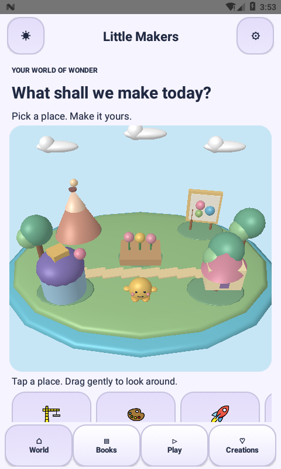

# Little Makers 2.4.0 — native 3D village and motion

## Visible changes
- Replaces the Home bitmap backdrop on GLES2-capable devices with a native mesh scene: sculpted island, clay volcano, painting easel, shape observatory, story treehouse, garden, clouds and companion.
- Uses a perspective camera, depth buffer, shaded materials and specular highlights. Drag horizontally to orbit the camera within bounded angles. Tap a landmark to make it bounce and enter its activity. Persistent illustrated destination buttons provide equivalent navigation without precision picking.
- Clouds drift, canopies sway, the companion bobs and observatory shapes turn. Reduced-motion or disabled system animation freezes decorative movement while camera gestures and navigation remain available. Unsupported GLES2/shader configurations fall back to the previous artwork; activity buttons remain usable.
- Adds short screen entrances, eased story-prop placement, story success particles, floating shape pieces and stronger 1.6-second game-win particles. Existing distinct tap/note/win sounds and haptics remain in place. No strobing or random-reward loops.
- Pauses/resumes the village renderer with the Activity and removes delayed navigation callbacks when its view detaches. Mesh buffers are reused and shader locations cached.

## Scope
The village and clay are genuine 3D mesh renderers. Stories remain animated 2D sprite scenes; coloring, books and most learning boards remain 2D. This change does not convert all content into 3D or add prerecorded animated videos. The 1,053-picture catalog, 210 story scripts, saved drawings, existing 1,200 levels and wallet rules are retained.

## Validation
Direct SDK 36 APK build/signature verification; existing rule/state, save-compatibility, audio, navigation, palette/schema and release-guard checks; bundled-picture/story asset regression; new deterministic village-motion tests for clamped time, bounded camera angles, landmark routing, response decay and reduced-motion behavior. See verification/MOTION-2.4.0.json for emulator observations and limits. Hardware frame-rate, broad device compatibility, full TalkBack and production Play submission remain unverified.

## Android Studio
Use main, sync the existing project and run the Little Makers Android App configuration. This update preserves the repository's Android Gradle plugin and wrapper settings. The direct SDK helper is a separate build path, not proof that remote Gradle dependencies resolve in every environment. Preserve your existing signing key to upgrade without clearing local data.

## Actual emulator capture

