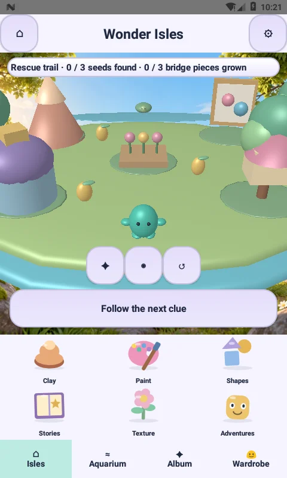
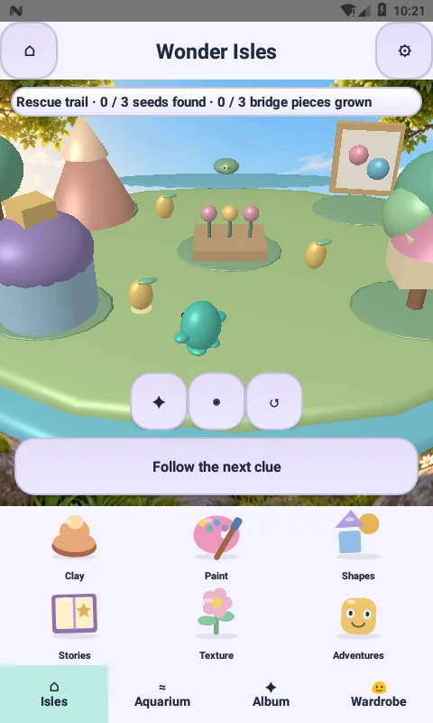
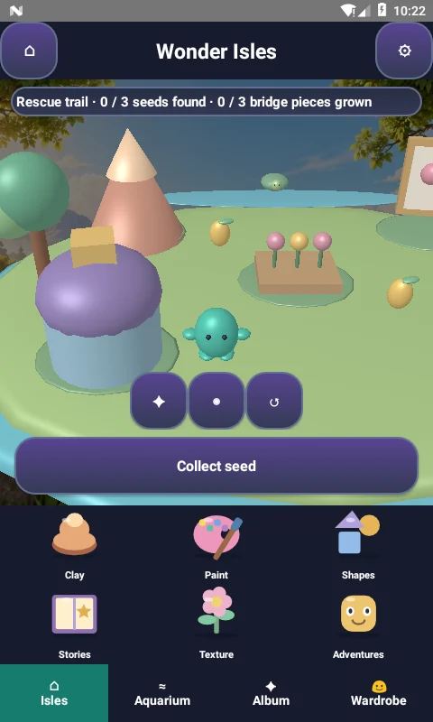

# Little Makers 3.3.0-native (30)

## Visible changes

Wonder Isles now reserves the available screen height for the live 3D island. The old vertical destination-button list and scrolling world container are removed. Six original Canvas-drawn toys (clay mound, palette, shapes, book, flower and companion) bob and tilt in a compact two-row dock, with all six visible. Each has a native accessible click target at least 64dp wide, a spoken label and immediate press feedback. The dock adds no second GL context. The remaining contextual action, clue, camera controls and bottom navigation remain available.

The island is still stylized procedural 3D. The dock is animated 2D artwork. This release does not claim photorealistic rendering or a rewrite of every activity.

## Responsiveness changes

* Sound synthesis, AudioTrack creation, PCM writes and release now run on a shared audio HandlerThread rather than the UI thread. A bounded 24-entry PCM cache reuses sounds. Pending sounds are coalesced per owner and stop invalidates pending playback.
* Island input and pathfinding are queued on the GL thread. The renderer no longer holds the state monitor while issuing the entire scene's draw calls; main-thread snapshots therefore avoid that long critical section.
* Island meshes use persistent GPU vertex buffers instead of client arrays on every draw. Ground-picking ray buffers and the companion-side loop avoid repeated temporary arrays.
* Mission labels update only when their value changes; polling is 350ms rather than 200ms.
* Shared control factories react on touch-down using scale transforms. Font objects are cached. Reduced-motion settings disable press and dock animation; a stationary reduced-motion island renders only on demand, while travel continues to update.
* Dock animation pauses when the activity leaves the foreground and uses a 33ms invalidation interval. The world retains display-paced rendering when motion is enabled.

## Validation

See `verification/MOTION-3.3.0-rules.txt` and `verification/MOTION-3.3.0-device.txt` for actual results. The device instrumentation checks world visibility, six accessible toys, live rendering, queued walking, navigation, audio bursts, and dark/reduced-motion presentation. Screenshots are actual emulator captures, not mockups.

These checks do not certify 60fps or zero lag across physical devices. The APK is a development-signed update, not a Play production release.

## Actual captures

