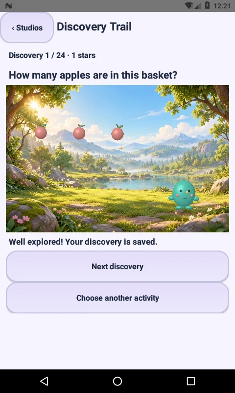
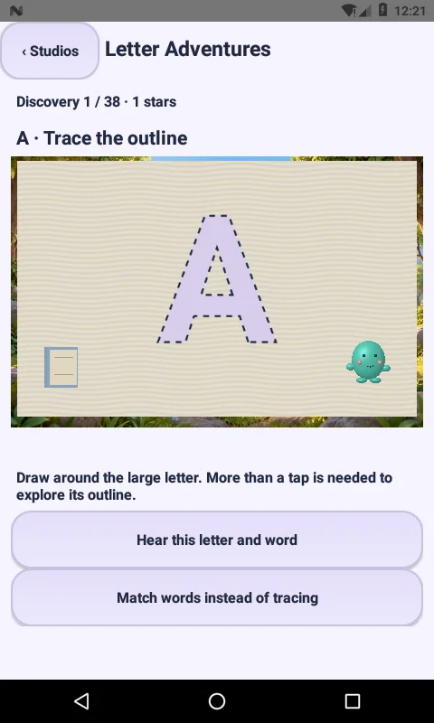
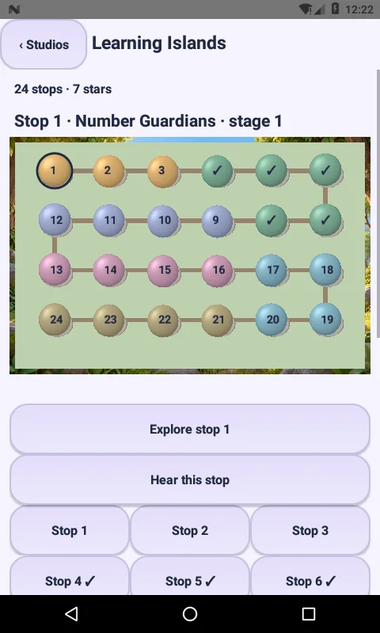
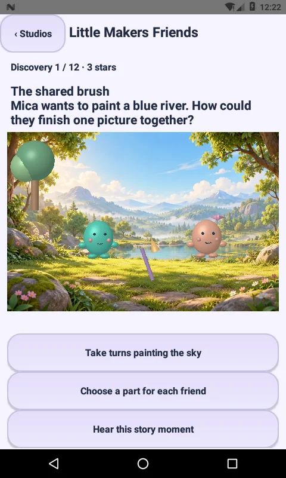
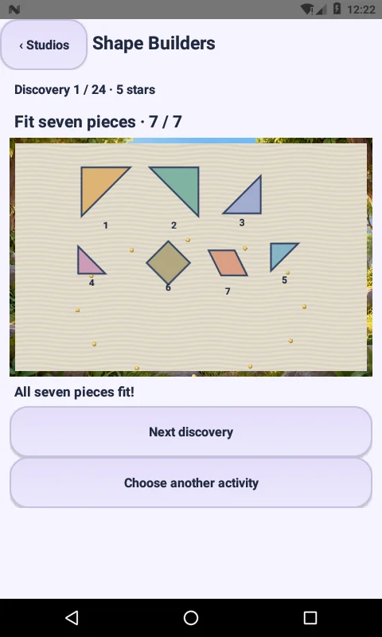
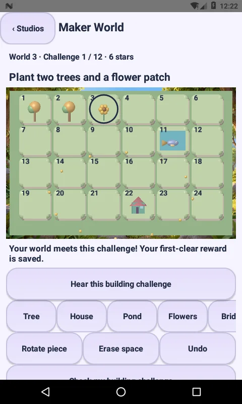
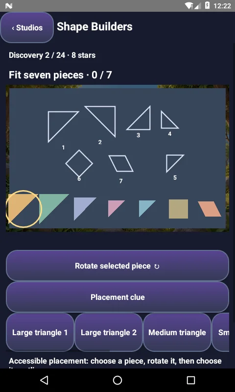

# Little Makers 3.0.0 — All nine original learning experiences

Open **Play → All 9 learning adventures · new studios** near the top of Wonder Isles. The same menu is available from Little Playroom. All nine entries launch internal native activities; there are no external game links or embedded websites.

| Experience | Playable implementation | Included content |
|---|---|---|
| Number Guardians | Locally adaptive counting, addition and subtraction; answers bloom a 3D garden | Existing 24 stages |
| Balance Workshop | Add/remove weights, test equality, compare moving balance pans | Existing 24 stages |
| Robot Routes | Edit forward/turn commands; run the robot with eased movement and collision feedback | Existing 24 stages |
| Discovery Trail | Scripted counting, nature, word-sound, pattern and kindness questions with 3D objects and contextual clues | **24 new lessons** |
| Letter Adventures | Trace letter outlines by actually covering the guide, then match a word; assemble short words with undo/check controls | **26 letter lessons + 12 word-building tasks** |
| Learning Islands | A visible path linking to actual stages across the other eight experiences; progress comes from the central completion ledger | **24 linked stops + 6 island milestones** |
| Little Makers Friends | Pip and Mica react to choices in short, branching social-emotional stories; chosen story branches persist | **12 stories, 2 choices each, 48 possible two-choice routes** |
| Shape Builders | Seven native extruded polygon pieces; drag, rotate and snap into size/orientation-matched outlines; accessible button placement also available | **24 arrangements** |
| Maker World | Paint trees, houses, ponds, flowers, bridges and friends into editable worlds; rotate, erase, undo, switch and save worlds; optional challenges check actual layouts | **6 saved worlds, 24 spaces each, 12 building challenges** |

This release adds **110 learning/story/building tasks**, plus the linked learning map and its milestones. Together with the original three quests there are **182 tasks across eight game/creative experiences, and one progression-map experience**. Map stops reuse real stages; they are not counted again as new lessons. These are original Little Makers implementations of broad learning ideas, not copies of third-party apps or their content libraries.

## Native implementation

- `ExplorerCatalog`: bundled original question scripts, letter/word prompts and branching dialogue. No runtime text generation or remote content service.
- `ExplorerState`: bounded lesson and story progress, word assembly and validated save restoration.
- `TangramState`: seven-piece position/rotation/snap rules, matching geometry and atomic restoration. Arrangements are original spaced shape-placement exercises, not a full library of classic contiguous tangram silhouettes.
- `MakerState`: 24-cell layouts, six item types, predictable building goals, adjacency checks and validated layouts. Six layouts are saved independently.
- `TraceTrack`: font-outline sample coverage. A single random tap does not complete a letter. Partial coverage is retained; matching words without tracing is an explicit alternative for children who cannot perform the motor gesture. These are outline exploration activities, not handwriting stroke-order assessment.
- `StudioBoardView`: actual touch gestures, tracing ink, outline guides and accessible alternatives over the shared 3D renderer.
- `ExplorerScenes`: immutable display lists for objects, characters, map nodes, shape pieces and world tiles.
- `NativeStageSurface`: extended with custom extruded triangle/parallelogram meshes and rotated world props. Existing node constructors default to zero rotation so old scenes retain their behavior.
- `StudioActivity`: native visual/voice controls, lifecycle management, per-lesson progress, six world slots and internal navigation.
- `OfflineNarrator`: optional installed English system voice that does not require a network. The application does not download a voice, record audio or request microphone access. Written and visual prompts remain usable without speech. This is system narration, not a bundled phoneme-recording curriculum.

## Progress, wallet and reset

New first clears use the existing transactional completion table and wallet ledger: **5 coins and 1 star** per stable task key. Reloading or replaying the same task does not pay again. A completed four-stop island earns its milestone once. Entering an activity alone never completes a map stop.

New local preferences use `explorer_studios`. Letter coverage, selected lessons, story choices, fitted pieces and world layouts survive Activity recreation. Parent Reset clears this store alongside the existing game stores. The existing reset generation marker prevents an older paused studio from reviving cleared progress. Existing wallet, wardrobe, artwork, original stories, rescue and aquarium remain connected.

## Scope and limits

The scenes use stylized native meshes, a shared illustrated forest backdrop and motion. Tracing guides, labels and board artwork are flat overlays on those scenes. This is not photorealistic or AAA rendering. Friendship stories are interactive scripted scenes, not prerecorded videos. Shape Builders is digital; camera-based physical-object recognition is not included. Maker World is an offline local sandbox with no online sharing, public chat, or multiplayer.

No runtime dependencies or Android permissions were added. There are no ads, analytics, timers, expiring rewards, external game installs or paid random items. Target SDK is 36, min SDK 24. This debug APK is not a production Play-signed release or an assertion of Play approval.

## Verification

- SDK 36 resource/Java/DEX compilation, zip alignment and APK v2/v3 signature verification passed.
- Existing regression suite passed, including 1,200 legacy level solvability, save fixtures, theme contrast and the previous three quest rule checks.
- **1,974 new rule assertions passed:** 24 discovery questions, 38 reading tasks, all 48 friendship routes, all 24 seven-piece puzzles, all 12 building goals, distinct map destinations, tracing thresholds, bounds and atomic malformed-save rejection.
- Source guards verify internal navigation, no new permissions/external content, central rewards, reset integration and offline speech selection.
- **API 24 software-GLES emulator integration passed, with 10 actual screen captures:** all-nine menu entry, wrong/correct answers, actual tracing motion with single-tap rejection, word assembly/undo, story branch restoration, wrong-orientation rejection, real shape dragging and accessible placement, world edits/undo/slot saves/recreation, shared rewards and idempotent island milestones, launching a specific existing quest stage, return-to-map completion updates, and dark/reduced-motion visuals.
- Device logs: `verification/NINE-ADVENTURES-3.0.0-device.txt`; rule log: `verification/NINE-ADVENTURES-3.0.0-rules.txt`.

Physical-device frame-time measurements, a broad Android/GPU matrix, full accessibility review and release/publisher checks remain separate. No 60fps certification or all-version compatibility is claimed.

## Actual emulator captures

