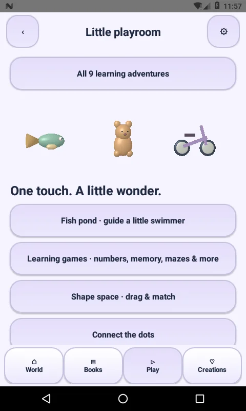
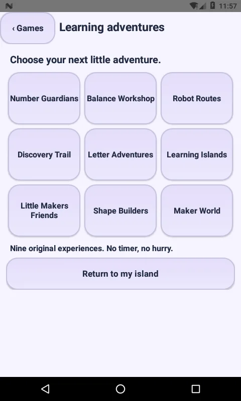

# Play-tab discovery fix — 3.0.1-native

The CreativeActivity **bottom Play tab** had five older shortcuts and no direct entry to the nine-adventure catalog. Earlier releases added that catalog to Wonder Isles and MainActivity's games list, leaving this separate playroom screen disconnected.

3.0.1 adds **All 9 learning adventures** as the first playroom button, ahead of the header and older shortcuts. The older World page also has a direct shortcut. The catalog now uses a responsive two/three-column grid instead of a long vertical list, keeping the newer studio options easier to discover. All nine destinations and their game logic are unchanged.

Install the Android 3.0.1 update, open the bottom **Play** tab, and tap **All 9 learning adventures**. Android Settings → Apps → Little Makers → App details/version can confirm `3.0.1-native` (version code 28). This native APK update does not publish a separate web preview.

The build uses the same development signing key as 3.0.0. Existing game data does not need to be cleared for this update.

## Checks

- SDK 36 compilation, alignment and APK signature verification.
- Existing regression suite, including original quests and six studios.
- Targeted API24 emulator regression starts from **CreativeActivity's Play route**, checks the new button is visible without scrolling, opens the catalog, checks all nine named options, launches all six studio activities through their buttons, and returns to the original playroom.
- Actual captures and device results are stored with this patch. No physical-device performance or all-version claim is made.

