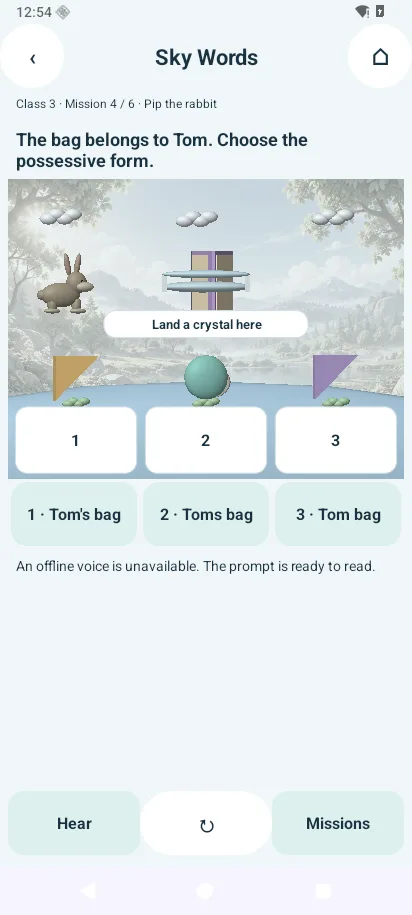
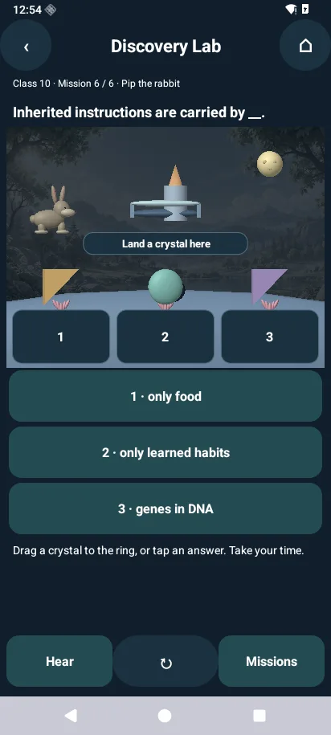
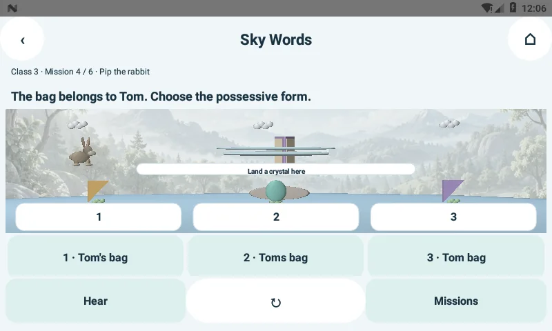
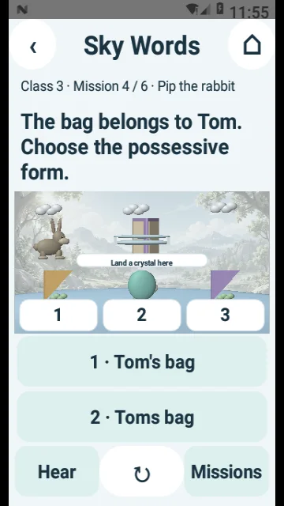
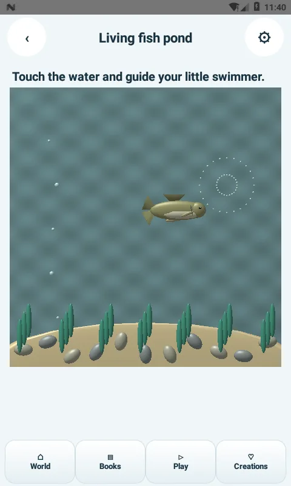
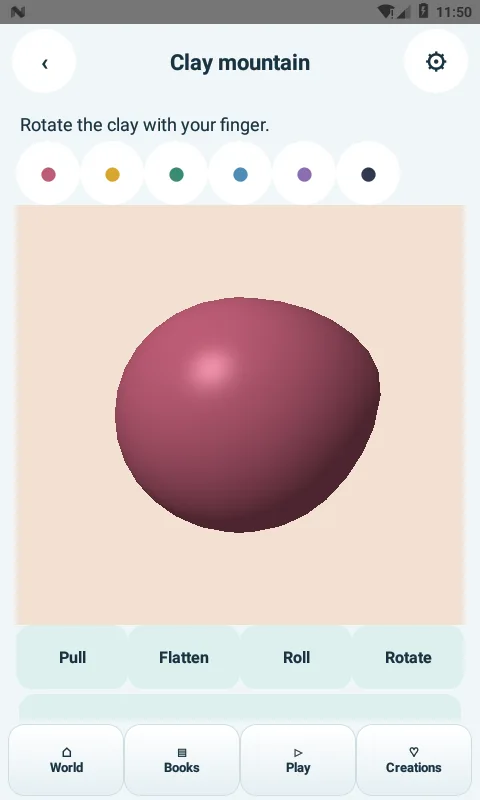
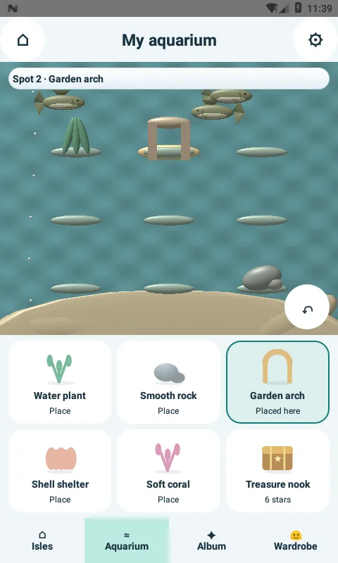
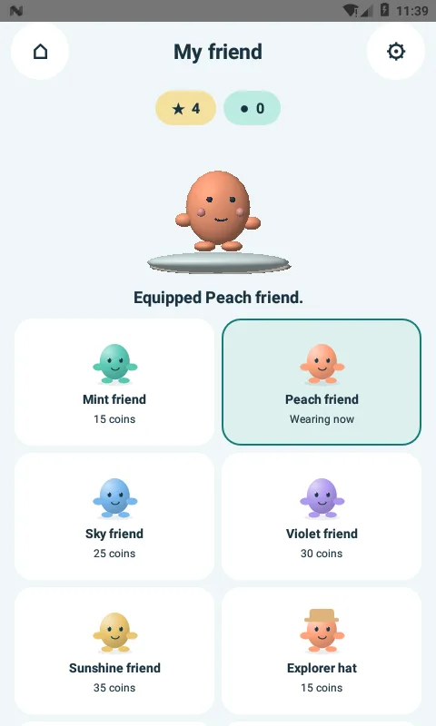
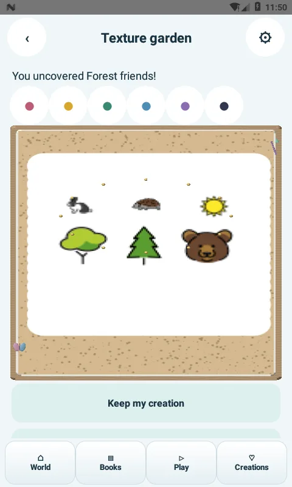
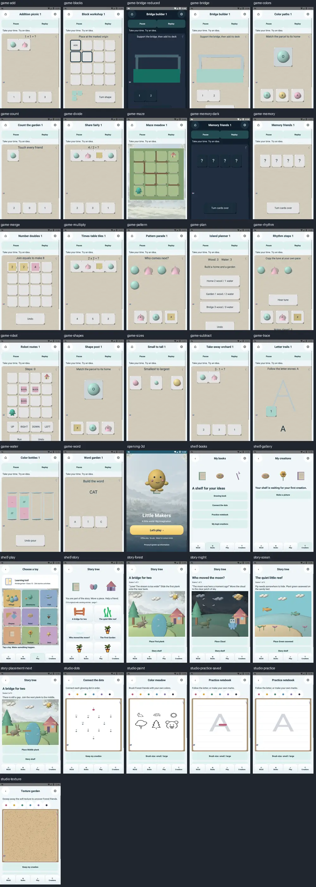

# Little Makers 3.6.1 — functional QA and visual audit

**Version:** 3.6.1-native (34). **Outcome:** full functional coverage below passed on API 24, with selected guarded compatibility checks passing on API 36. **Visual realism remains incomplete.** This is a development-signed debug APK, not Play release certification.

## Product fixes found by testing

1. A long school answer overflowed the old canvas label at a narrow width. Full answers now use native, measured, wrapping cards. Short answers share a row; long answers and larger fonts use vertical cards. Numbered crystal markers link the scene to the cards. Text is not stretched with the scene or ellipsized.
2. Mixed icon/text baseline alignment clipped the learning footer by a few pixels. Footer baseline alignment is disabled, controls are centred, and a bottom spacing allowance is present. Controls retain their 64dp minimum height.
3. An oversized scene pushed the third answer below the fold on a standard portrait screen. The responsive scene now reserves more room for answers. Small screens and large fonts can still require vertical scrolling; the footer remains outside the scroll.
4. Wide landscape scenes cropped some 3D props. School models now fit the viewport while retaining uniform proportions. World/input centres are unchanged. Pure geometry checks cover 175 viewport combinations.

All fixes preserve the existing wallet schema, completion IDs, drawings and parent PIN format. The recent development signing identity is retained. Instrumentation is compiled into a separate test APK and is not included in the child-facing app.

## Coverage and results

| Test | Scope | API 24 result |
|---|---|---|
| `tools/test.sh` | All 1,200 legacy modules solved automatically; 10,814 game rule/state checks; 400 saved-state fixtures; platform, asset, offline and release guards; quests/studios; all 264 school entries; 175 viewport checks | PASS |
| `Readability36Check` | All 792 school answer choices × 3 widths × 3 font scales × 2 themes = 14,256 combinations. Complete text, no ellipsis, measured width/height fit. Live mission footer visibility and Hear's offline-voice/fallback path | PASS |
| `RenderCheck` | 36 rendered screens, including all 20 legacy game types, art studios, shelves, story environments and opening. GL error checks; construction of all 630 story-step frames; notebook drawing persists after reopening | PASS |
| `QuestCheck` | Adaptive difficulty, balance, robot commands/undo/collision, wins, shared rewards, replay idempotence, recreation, dark/reduced motion | PASS — 8 captures |
| `StudioCheck` | Nine-adventure menu, actual tracing and shape rotation/drag, spelling, story choices and persistence, world editing/undo/save, learning-map completion/return | PASS — 10 captures |
| `AdventureCheck` | Guided walking, three seed collections, bridge construction, wallet reward, aquarium placement and recreation, linked paint/game entry, break dialog | PASS — 9 captures |
| `Hud34Check` | Wardrobe purchase/equip without repeat charges, renderer reuse, album, accessible aquarium slots, saved decorations, dark text and reduced motion | PASS — 6 captures |
| `Visual32Check` | Actual village/alias routing, direct adventure targets, fish touch motion, puzzle catalog, maze actor motion, theme/motion behavior | PASS — 7 captures |
| `Motion33Check` | Six accessible animated dock targets, live world frames, queued walking, K–10 entry, reduced-motion idle, nonblocking sound queue burst | PASS — 3 captures |
| `PlayroomCheck` | Real Play → Adventures entry, all nine menu entries, all six studio launch destinations, return to the same Play screen | PASS on rerun — 3 captures; timing qualification below |
| `Creative36Check` | Clay Pull/Flatten/Roll/Rotate, finite bounded vertices and saved geometry; actual shape drags and accessible matching; reward replay; paint/undo/brush/save/gallery; all 12 dots; texture sweeping | PASS — 1,658 assertions, mostly vertex-bound checks; 6 captures |
| `Parent36Check` | Mismatched/correct PIN setup, wrong/correct unlock, salted hash, theme/sound/motion, typed reset confirmation, database/inventory/private-file/activity-pref deletion, retained PIN/settings, local privacy page | PASS — 40 assertions |

The 1,200 modules are variants across 20 mechanics. The 264 school entries use three shared worlds. These counts are not counts of independent game engines. Rendering a game type is not a claim that every level was played manually.

### Device matrix

- **Android 7 / API 24:** AOSP x86_64, 480×800 at 160dpi, TCG CPU emulation and SwiftShader. Full functional suite above. School layout checks also ran at a 360×640 size override with 150% system font and in a real 800×480 landscape rotation.
- **Android 16 / API 36:** AOSP x86_64, 412×915 at 160dpi, TCG and SwiftShader. Guarded 36-screen rendering sweep, nine-step learning-flow suite, focused light/dark school views, and a fresh-task Reduced motion diagnostic passed. The 14,256 widget measurements also passed; early covered-window captures from that combined run are not counted as visual passes. Latest-platform results are recorded in `verification/qa36/results.json` and `verification/qa36/latest/logs/`.

These are software emulators. No physical Pixel/ARM/GPU/thermal benchmark, sustained 60fps measurement or complete intermediate-Android/OEM matrix was performed.

## Test failures and their disposition

- The narrow answer overflow and clipped/crowded footer were product defects and were fixed in this build. Landscape prop cropping was also corrected and rechecked.
- Older harnesses expected the 3.0.1 Play banner and pre-redesign aquarium buttons. They now follow the current controls and virtual accessibility nodes. Renderer checks locate the current menu surface and inspect GL error state.
- A preliminary parent-reset test clicked the editable word `RESET` instead of the confirmation button. Restricting the selector to a button resolved the false failure; the expanded 40-assertion reset test passes.
- The first sequential Play-menu run hit a 20-second timeout under software emulation. A rerun with a 60-second harness allowance observed the correct mode for all six destinations and passed. This is not evidence of acceptable real-device transition latency.
- Cold API 36 boot produced **Quickstep, Process system and System UI ANR dialogs**. Early assertions that continued beneath those dialogs are not accepted as visual passes. Capture checks now require the app package in the active window, actual activity focus, a rendered frame and nonblank school-scene pixels. After the observed OS dialogs were dismissed, the guarded rendering and learning runs passed. These were emulator system-process failures, not Little Makers exceptions.
- An API 24 screenshot attempt after changing the logical display size failed in the capture API. The landscape check was rerun using actual display rotation. Capture handling now supports a shell screenshot fallback and preserves the original test error.

- A preliminary light-to-dark instrumentation restart produced a blank surface. A controlled fresh-task Reduced motion launch passed with the original renderer (one frame). Isolating each theme in a fresh task resolved the sequential capture issue; the experimental renderer-redraw change was discarded. The final captures include real scene pixels, not only frame counters.

UI assertions are marshalled back to the instrumentation thread so a failed test does not masquerade as an app main-thread crash. Preliminary failures are not counted as passing runs.

## Is everything realistic now?

**No.** Native 3D geometry and reactive movement are present, but substantial stylized content remains:

| Area | Current state |
|---|---|
| Fish and several animals | Procedural, relatively low-detail anatomy-oriented meshes; no photographic scale/fur/skin textures or high-resolution skeletal animation |
| Village and aquarium | Real geometry and motion, with simplified materials and lighting |
| School and story scenery | 3D foreground meshes with a bundled 2D environmental backdrop; some shadows and lighting remain schematic |
| Wardrobe/avatar | Stylized original character |
| Coloring, texture, dots, notebook and catalog illustrations | Predominantly 2D artwork/canvas interactions |
| Stories | Scripted interactive scenes with short reactions; not cinematic video episodes |
| “4D” | No fourth-spatial-dimension rendering. Motion, sound and haptics do not establish photorealism |

A full photorealistic asset, rigging, animation and lighting replacement is outstanding. This QA run does not certify learning outcomes, child usability, complete screen-reader behavior, tactile feel, audible sound quality or content suitability for every child. The emulator verified the unavailable-voice fallback; audible narration with an installed offline English voice still needs a device check. K–10 content remains a starter collection, not a complete certified syllabus.

## Evidence and reproduction

Actual logs and build hash: [`verification/qa36/results.json`](verification/qa36/results.json), [`verification/qa36/logs`](verification/qa36/logs), and [`verification/qa36/latest/logs`](verification/qa36/latest/logs). Selected genuine captures are below; no generated mockups are used as test evidence.

**Safety for reproduction:** instrumentation tests reset their disposable app profile and private files. Never run them against a child's active profile. The non-device rule suite is `JAVA_HOME=<JDK> bash tools/test.sh`. Build the separate test APK with `tools/build-render-check.sh`, then select the intended disposable emulator explicitly with `adb -s <serial> shell am instrument -w com.littlemakers.village.rendercheck/.<TestClass>`.

### Actual captures

A rejected cold-boot capture showing the **System UI** dialog is retained separately as [environment diagnostic evidence](verification/qa36/evidence/system-ui-diagnostic.webp); it is not a successful app screenshot.
