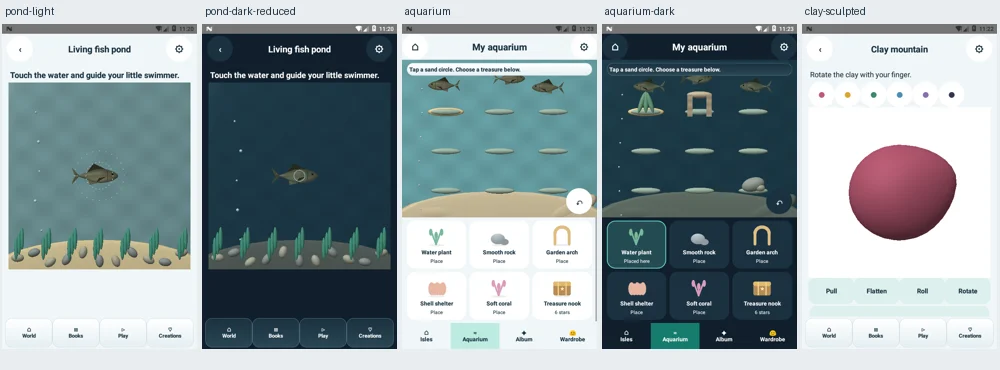

# Little Makers 3.7.0 — interrupted publication recovery

Recorded 30 October 2026. Development and tests below completed in the preceding 29 October session. **No new build or test was run during this recovery: the execution environment is unavailable.**

## Available APK

[Download little-makers-native-3.7.0-debug.apk](https://chatgpt.com/library?file_id=libfile_fcd77c756f248191947415b95c073d19&account_id=personal)

- Application: `com.littlemakers.village`
- Version: `3.7.0-native`, versionCode 35
- Minimum SDK 24; target/compile SDK 36
- Saved size: 19,503,189 bytes; saved version 1
- Previously measured SHA256: `5b46f84cb724fbfb8363fb89c6ebc89b6409853cf080a3c7961d5432553b3366`
- Existing development signer; v2/v3 signature verification passed. This is a debug APK, not a Play release upload.

The saved APK was confirmed to remain available on 30 October. Its bytes were not downloaded or rehashed during this recovery.

## Implemented in that APK

- Shared original fish anatomy mesh in pond, aquarium and ocean stories: tapered body, forked tail, fins, paired eyes, countershading, scale/fin/gill detail and GPU body bending. One uploaded buffer and one draw call per fish.
- Shared restrained lighting/materials across village, adventure, aquarium, pond/shape and story/game renderers.
- Clay normals calculated from deformed triangles; reused buffers/matrix storage and cached shader handles. Clay background follows the app theme.
- Ocean sky clouds replaced with rising bubbles; separate swaying seaweed fronds replace the generic seedling shape.
- Existing wallet schema, reward IDs, saved creations and parent PIN format retained.

## Previously observed validation results

These are recorded results from tool outputs in the preceding session, **not fresh reruns or a substitute for the currently inaccessible raw logs**.

| Scope | Recorded result |
|---|---|
| Complete host rule/content/platform suite | PASS; includes 1,200 module solvers, 10,814 rule/state checks, 400 saved-state fixtures, audio PCM and offline/content guards |
| New fish/clay numerical geometry tests | PASS — 28,218 assertions, mostly finite-value/normal/bounds checks, not game counts |
| API24 candidate functional coverage | Thirteen named instrumentation suites passed individually after documented harness fixes |
| API24 answer-layout matrix | PASS — 14,256 combinations across choices, widths, font scales and themes |
| API24 parent controls | PASS — 40 PIN/reset/privacy/settings checks |
| Final APK API24 rendering retest | PASS — 36 screens, GL_NO_ERROR, construction of 630 story-step frames |
| Final APK API36 fish | PASS — 21 checks, real pixel motion, touch, light/dark, reduced motion, GL errors and forced context recreation |
| Final APK API36 rendering | PASS — 36 screens, GL_NO_ERROR, construction of 630 story-step frames |
| Final APK API36 school UI | PASS — two live light/dark screens, actual nonblank scene pixels, visible controls and offline-voice fallback |
| Final APK API36 creative tools | PASS — 1,658 checks including clay input/save, shape drag/rewards, painting/undo/gallery, dots and texture reveal |

API24's thirteen-suite aggregate ran on candidate hash `4748ecce3f502f8e62ebc6e1f5cc54f01c8e2c3d0638a9ec47f9a92344b2b68d`. After the final ocean-only correction, the affected 36-screen rendering sweep was repeated on API24. The four selected API36 checks ran on the final APK. The installed API36 APK hash was checked against the final hash above.

Both devices were disposable AOSP x86_64 software emulators, 480×800 at 160dpi, using TCG/SwiftShader; no physical Pixel/ARM/GPU/FPS certification. API36 was retried with a 2048MB memory launch option.

Preliminary failures must not be hidden: API36 setup suffered system death, Bluetooth crashes and a System UI ANR before stable testing. A first fish run failed the visibility guard. Harness fixes awaited real resumed activities, supported owned-dialog capture, avoided pre-first-frame content replacement, and waited for actual presented nonblank pixels. Strict package/focus/pixel checks remained. System window/transition animations and crashing emulator Bluetooth were disabled; app animator scale remained 1. No app renderer patch was introduced solely to mask these harness/setup failures.

## Source publication is unfinished

**The repository application source is still 3.6.1. It does not reproduce the saved 3.7.0 APK.** This recovery commit only adds documentation and an already-uploaded candidate capture; it does not publish 3.7.0 application code.

The execution server failed before the tested source, raw logs and full QA package were committed. Do not regenerate source from memory and label it as the tested APK's matching source.

When execution access returns, first inspect the existing working tree rather than overwriting it:

- Worktree: `/workspace/little-makers-retry`
- Local final APK: `build/little-makers-native-debug.apk`
- Tests/evidence: `verification/qa37`
- Toolchain: `/workspace/lm-tools`
- Report generator: `/workspace/lm-tools/report37.py`

Recover the four new classes `FishGeometry.java`, `FishRenderer.java`, `SceneMaterials.java`, `SurfaceNormals.java`; changes in `NativeStageSurface`, `HabitatSurface`, `PlaySceneSurface`, `VillageSurface`, `AdventureSurface`, `ClaySurface`; version/build script changes; geometry/device tests and the disposable-profile test runner. Preserve the existing signing key; never publish it.

Then verify the recovered APK hash, inspect the exact source diff and raw logs, complete the QA package, recheck both remote branch heads, and publish the matching tested source using non-forced updates. If the worktree cannot be recovered, a reconstructed source build needs fresh compilation and validation and must not be claimed byte-identical to this APK.

## Remaining product limitations

Full photorealistic assets/rigging/PBR and cinematic story videos remain unfinished. Non-fish characters/buildings are still stylized; forest backgrounds and coloring/dots/notebook art remain 2D. Motion/haptics do not constitute literal fourth-dimensional rendering. No full Android/OEM matrix, sustained physical 60fps, audible narration/haptics, complete manual screen-reader/child-usability or Play-review certification is claimed.

## Candidate capture retained from development

This is a genuine 3.7 development capture, not a mockup or evidence that the currently published 3.6.1 source contains these changes.

