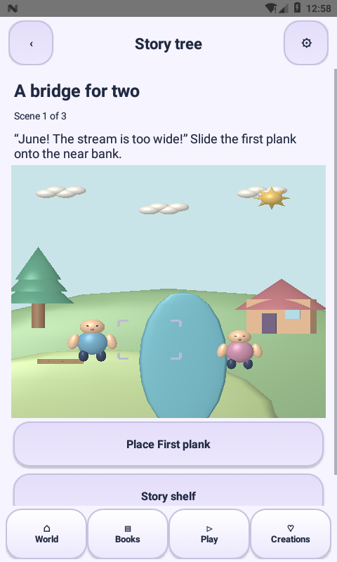
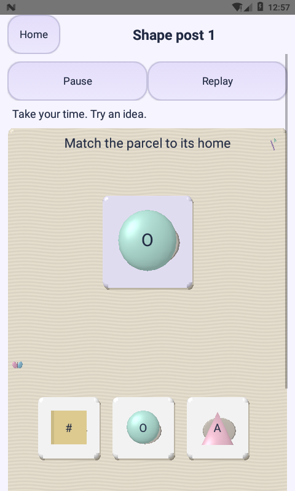
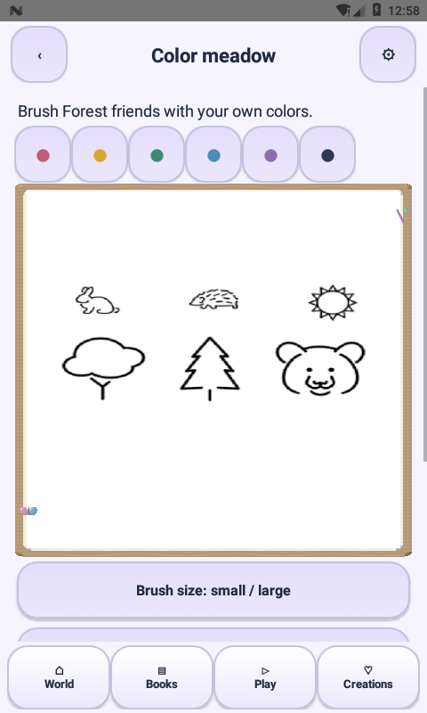

# Little Makers 2.7.0 — app-wide 3D rendering pass

## Audit and implemented coverage

| Area | Previous rendering | This release |
|---|---|---|
| Opening | Animated vector mascot over a picture | Mesh companion and physical book over the original environmental backdrop; subtle backdrop drift |
| Village | Native GLES2 meshes | Existing native village retained |
| Clay | Deformable mesh | Existing mesh sculpting retained |
| Shape Space / Fish Pond | Native 3D since 2.6 | Retained |
| All 20 legacy game types / 1,200 levels | Flat Canvas geometry | Mesh-backed pieces, platforms, letter/number tiles, cards, tracing paths, maze walls, coding obstacles, bottle rims/layers and bridge parts. Original text, hit regions, accessibility nodes and rules remain above the scene |
| Story Tree / 210 scripts | Sprite characters and raster props | Mesh forest, reef and night dioramas; animated human characters, fish, clouds, plants and native semantic models for all 41 prop asset identifiers across 630 steps. Placement and the existing two-choice endings remain interactive |
| Coloring / Texture Garden | Flat drawing surface | Editable picture/texture on a physical lit drawing board, with animated 3D tools/companion detail |
| Dots / Practice Notebook | Flat drawing surface | The same physical 3D board, preserving drawing coordinates, saves, undo and page progression |
| Books / Playroom / picture shelves / gallery | Static headings/cards | Shared animated mesh showcases, raised native buttons and existing spring press feedback |
| Friend / rewards shop | Canvas character | Native mesh companion in the chosen skin, including equipped hat/bow/star |
| Parent settings / privacy / credits | Native text and controls | Readable native information with raised controls; settings and legal copy do not drift or rotate |

## What 3D means here

`NativeStageSurface` renders actual meshes with a depth buffer, normals, directional light and specular highlights. Game geometry is submitted as immutable `SceneFrame` snapshots while the original `GameView` retains the gameplay rules, labels and accessible hit targets. This is not an embedded website, third-party game launcher, video playback or a screenshot placed over the entire game.

Story prop mapping is explicit in `StoryModels`. A missing identifier fails coverage checks rather than silently becoming a generic cube. The 41 asset identifiers share 36 semantic models where appropriate (for example different fish assets use a fish model). Models and animation are procedural and original. Existing attribution remains for coloring artwork and old fallback assets.

Art pages are intentionally flat media on a 3D drawing board; their 1,053 illustrations are not 1,053 sculpted models. Labels remain flat, readable text on or above objects. Catalog covers still use existing picture thumbnails, accompanied by live 3D showcases. The opening/village retain an illustrated environmental backdrop behind geometry. Graphics fallbacks still provide the original Canvas activity if GLES initialization fails.

This is stylized toy-like 3D with material lighting, not photorealistic rendering or 210 individually produced animated films. Physical-device performance, measured 60fps and a broad Android/GPU matrix remain acceptance work. No statement of full Play Store approval or all-device compatibility is implied.

## Interaction and lifecycle

- Shape/character idle motion is subtle; exact puzzle targets and reading labels stay in place.
- Pressed platforms lift briefly; story placement eases into its target; characters blink/walk/react. Win particles stop after 1.6 seconds.
- Reduced-motion and system animation settings switch shared scenes to render-on-demand. User input remains available.
- GL rendering pauses with each owning Activity. Texture uploads are bounded to a 320×420 preview; the full-resolution artwork and saved drafts remain unchanged. Latest image data survives GL context recreation.
- Existing game IDs, first-clear rewards, PIN gates, offline behavior and SQLite progress are preserved. No runtime engine, ad SDK or network permission was added.

## Verification

`tools/test.sh` covers the existing rule/save/audio/navigation/content tests plus immutable scene handoff, finite geometry and complete story-model mappings. `tools/build-render-check.sh` builds a separate instrumentation APK with no runtime test-library dependency. Run it only on an isolated emulator; it opens all 20 mechanics, dark/reduced-motion samples, three story environments, all 630 story-step builders and four art-board modes. Real screenshots and outcomes are recorded in `verification/THREE-D-2.7.0.json` after the run.

Build with your existing signing key to preserve installed-app data. The supplied debug APK is for review; production signing and publisher policy configuration remain separate.

## Device results

36 mesh-rendered screen checks passed on the API 24 software emulator. All 630 scripted step builders completed; a practice stroke survived save/reopening; story placement advanced to the next scene. This is render and targeted-interaction verification, not a claim of complete gameplay testing on every level or measured device frame rate.

