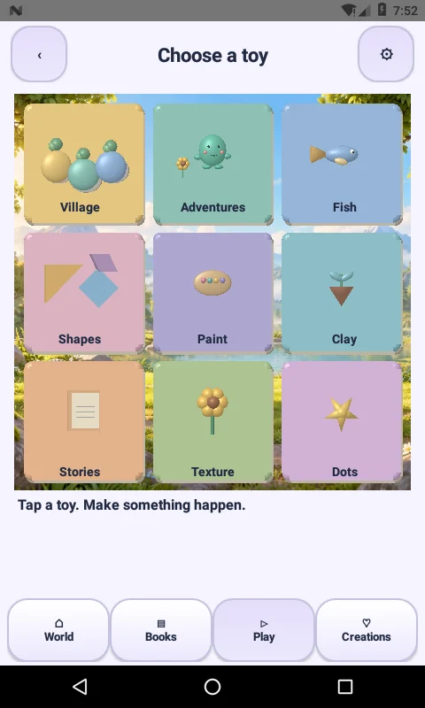
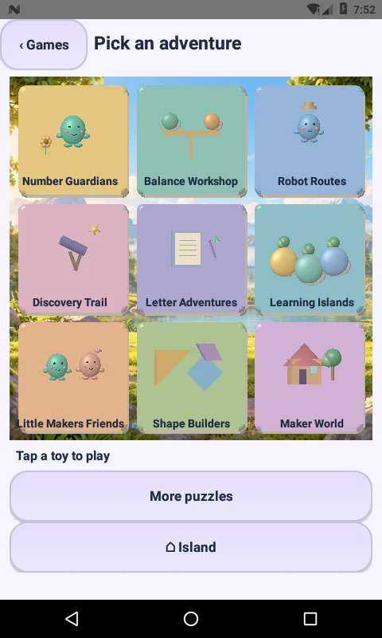
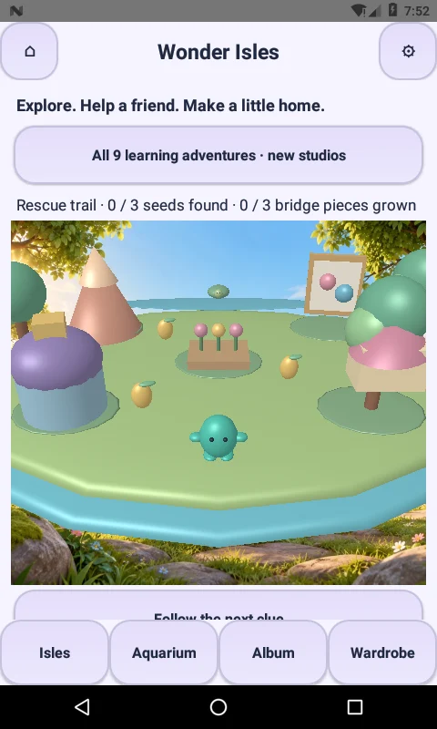
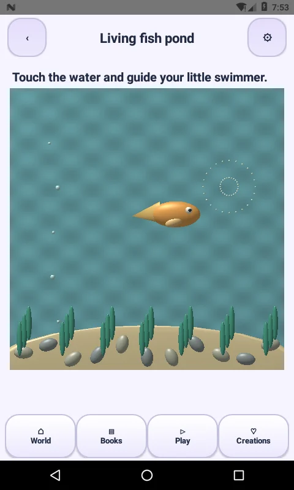
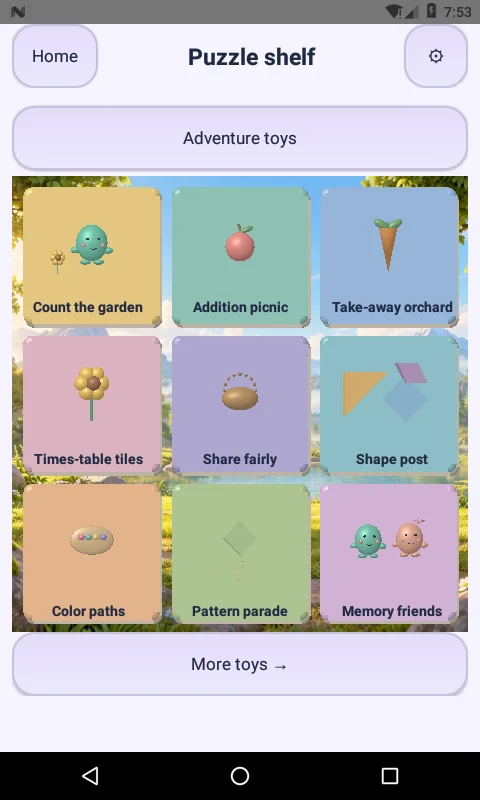
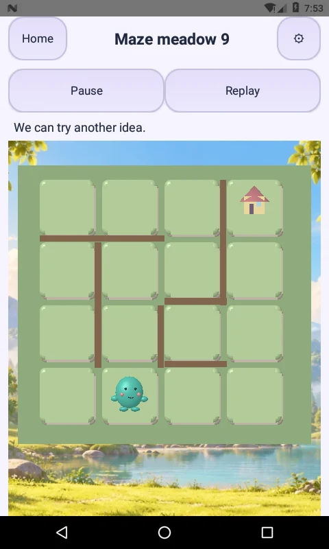
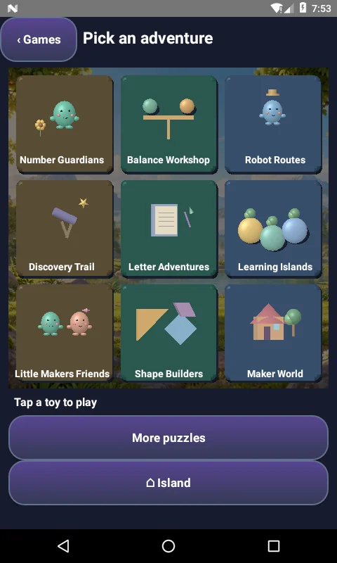

# Little Makers 3.2.0 — Picture-first play and branch reconciliation

## Why the earlier screens looked unchanged

The repository default branch was **master**, still version **2.5.0-native**, while the newer native renderers, nine learning experiences and launcher fixes were on **main**, version **3.0.1-native**. A checkout of the default branch therefore did not include those changes. This release merges master’s theme-toggle, IDE and configuration-cache changes into the newer application and synchronizes both branches without discarding either branch’s commits.

This does not inspect or overwrite uncommitted changes in a separate Windows checkout. Use the supplied APK to see this exact build. Parent space now displays the installed version and reported OpenGL ES capability.

## Changes a child can see and use

- **Play tab:** nine large illustrated targets, each with live native 3D objects: Village, Adventures, Fish, Shapes, Paint, Clay, Stories, Texture and Dots. A child can tap a toy directly instead of reading a long menu.
- **Nine adventures:** live character, book, telescope, balance, robot, island, shape and house previews replace text-only cards. Labels stay short in the playroom; the adventure catalog keeps recognizable activity names for parents and screen readers.
- **Puzzle shelf:** the twenty original mechanics are shown as paged picture cards. Level selection uses the same toy-card presentation. Wallet statistics, privacy and parent setup no longer fill the child’s main picker; the PIN-protected parent gear remains available.
- **Village routing:** the Village toy opens `AdventureActivity` directly. Explicit `world`, `explore`, `village`, `world-explorer` and `adventure` aliases in legacy routing also open the island. They no longer silently fall through to MainActivity’s old Home list.
- **Maze:** grassy lit tiles, wooden walls, a house destination and a smoothly moving companion replace the old grey board appearance. Logical moves, collisions, saved progress and rewards remain governed by the existing rules.
- **Fish pond:** the updated build reaches the existing native mesh fish scene, with touch-following motion, fins, bubbles, plants and rocks. It is not the old flat drawing-board fish view shown in the feedback.
- **Motion and accessibility:** native touch targets remain large; picture labels inherit dark/light text colors. Pressing a toy lifts its platform. Idle mesh motion is paused when the screen is hidden and disabled by reduced motion. Theme/motion changes rebuild the catalog on return.

The nine learning experiences and their content counts are unchanged from 3.0.0. See `NINE-ADVENTURES-3.0.0.md` for exact counts and scope. This update improves discovery, routes and presentation; it does not add thousands of new games or prerecorded story videos.

## Rendering limits

These are stylized procedural native 3D meshes and an illustrated backdrop, not photorealistic or AAA graphics. Labels, painting media and tracing guides are still flat where appropriate. The seven-piece arrangements use their existing puzzle geometry; menu previews show lit toy versions. Devices that cannot initialize the 3D preview retain an animated illustrated picker with the same native controls. Parent space exposes the build/GLES report to help diagnose such devices.

No runtime dependencies, external game links, ads, analytics or Android permissions were added. Existing wallet, drawings, private saves, outfit purchases and parent PIN are retained. Target SDK 36, min SDK 24. This is a development-signed APK, not a Play release certification.

## Verification

- SDK36 resources, Java, DEX, alignment and APK signature checks passed.
- Existing rule/save/palette/content checks passed, including 1,200 legacy stages, the three original quests and six studios.
- New pure route checks cover five village aliases and distinguish gameplay/settings destinations.
- API24 software-GLES emulator: **seven captured flows passed**. Tests verified continuously rendered mesh previews, actual Village entry and legacy village alias routing, all nine activity targets, native studio entry, fish movement after a touch, the illustrated puzzle picker, actual maze movement, white dark-mode labels and reduced-motion idle rendering.
- Logs: `verification/VISUAL-PLAY-3.2.0-device.txt`, `verification/VISUAL-PLAY-3.2.0-rules.txt`.

No physical-device 60fps certification or broad GPU/Android-version matrix is claimed.

## Actual app captures

